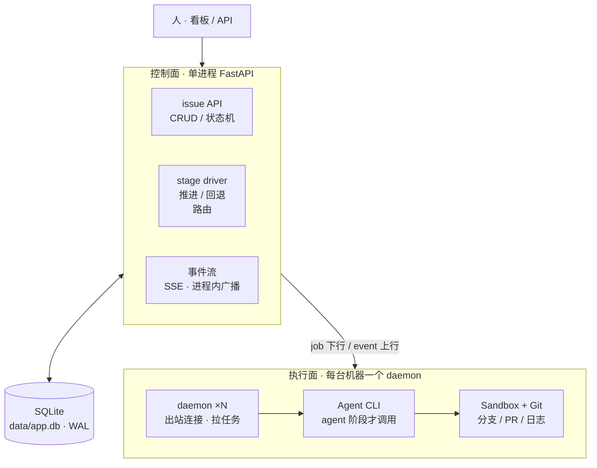
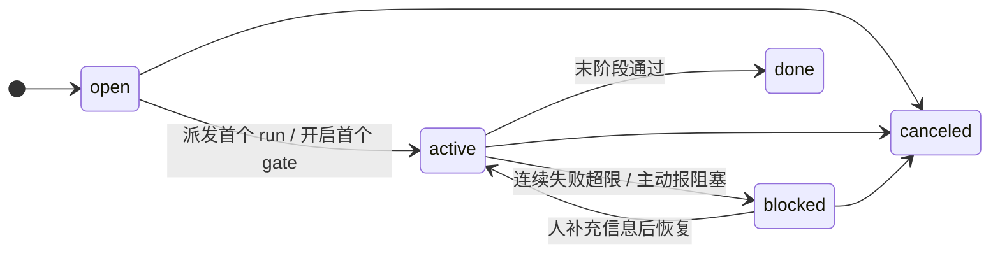
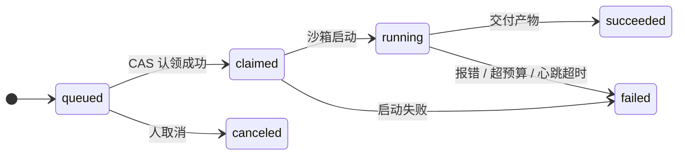
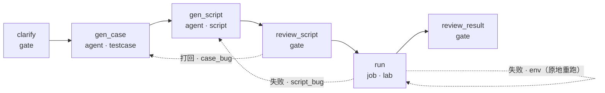
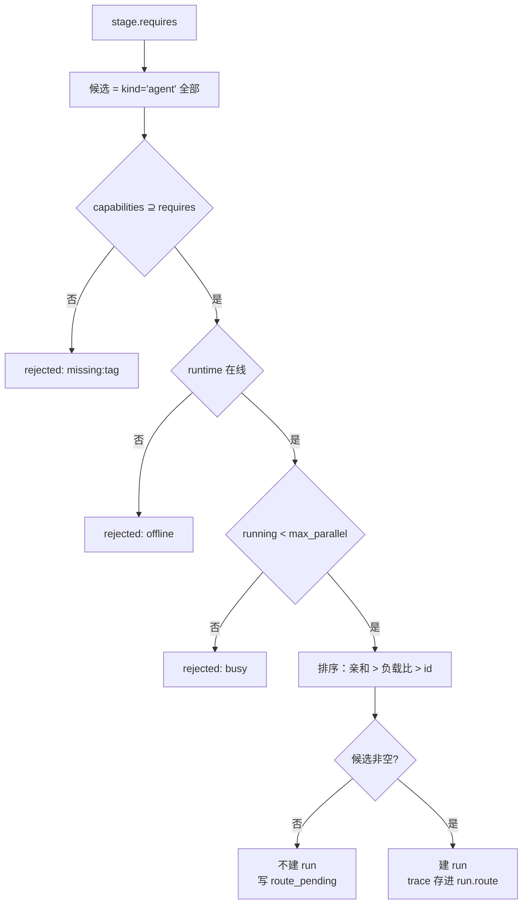

# Issue & Agent 系统设计

> 参考对象：Multica（issue tracker，assignee 可以是 coding agent）
> 定位：2–5 人小团队自建自用。一台机器、一个进程、一个 SQLite 文件。

---

## 0. 一句话定位

**把 agent 做成 assignee。** 不为人与 agent 设计两套模型 —— 两者都是 `actor`，issue 分给谁都一样，
区别只是 actor 背后是「人打开看板」还是「daemon 拉起 CLI」。

规模前提决定了每一个取舍：不做多租户、不做权限矩阵、不做插件体系。小团队要的是
**今天就能跑起来、出问题能一眼看懂**，不是能承载一千人的平台。

技术底色同理：**Python 标准库 + SQLite，一个进程跑完全部**。没有额外服务要装、要连、要运维。

---

## 1. 第一约束

> agent 跑在用户自己的机器上，控制面无法入站连接。

这一条决定整个通信模型：**所有连接由执行面发起，控制面只做应答**。

| 常规做法 | 本设计 | 理由 |
|---|---|---|
| WebSocket 双向通道 | 下行 SSE + 上行 HTTP POST | 不需要双向，单向推送足够 |
| 云端跑 agent 容器 | 本地 daemon 执行 | 代码与算力不出内网 |
| 控制面持有 git 凭证 | daemon 持有本地凭证 | 凭证永不上传 |
| Redis / MQ 做 fan-out | 进程内广播 + 事件落库 | 单进程，广播不需要跨网络 |

---

## 2. 架构



三层职责：

- **控制面**：维护状态、推进阶段、路由与派发 run。不跑模型、不碰代码、不存凭证。
- **事实源**：一个 SQLite 文件。事实从 `event` 派生，产物从 `artifact` 派生。
- **执行面**：daemon 是唯一可信执行代理，Agent CLI 是插件，Sandbox 是隔离边界。

一台机器一个 daemon，一个 daemon 可以承载多个 agent（不同模型、不同工具链）。
哪一步交给谁，由控制面在派发时决定（见 5.2），daemon 只负责执行拿到的 run。

单进程即可承载 2–5 人团队的负载。不做微服务拆分，也不做多实例 ——
拆分带来的部署与调试成本，在这个规模下远大于收益。

---

## 3. 领域模型：三个概念严格分离

| 概念 | 是什么 | 谁产生 | 生命周期 |
|---|---|---|---|
| **issue** | 一个工作流实例 | 人 | 长，跨天 |
| **run** | 机器执行的一次尝试 | 后端派发 | 短，几分钟到几小时 |
| **gate** | 等人的一个关卡 | 后端开启 | 不定，等多久算多久 |

这三个概念必须分开。把「执行」「人审」「进度」压进 issue 和 run 两个对象里，状态机就会互相打架：
issue 认为自己在 review，run 认为自己在跑，两者迟早不同步。

**关键决定：`gate` 不建 run。**

`run` 的生命周期绑定心跳与超时回收（60s 无心跳即判 failed），而人审没有确定时长 —— 审一天是常态。
所以 run 只表示「机器在跑」，人审用 `issue.awaiting_gate` 表达：不建 run、不心跳、不回收。

### 3.1 issue 状态（粗粒度）



**只有五个状态。** 进度由 `current_stage` 精确表达，`status` 只回答一个问题 —— **有没有卡住**。
两套机制同时描述进度，必然出现「status=in_review 但 stage=gen_script」这类不可能状态。

| status | 含义 | 与 stage 的关系 |
|---|---|---|
| `open` | 已创建，未开始 | 有编排 = 首阶段；无编排 = `NULL` |
| `active` | 工作流推进中 | 任意 stage（无编排为 `NULL`） |
| `blocked` | 需要人介入 | **stage 保持不变**，恢复后原地继续 |
| `done` | 全部阶段通过 | 有编排 = 末阶段；无编排 = `NULL` |
| `canceled` | 终止 | — |

`awaiting_gate` 非空时，issue 仍是 `active`（它在正常等着），只是看板上标黄显示「等人」。

issue 分**有编排**和**无编排**两种形态（见 4.8），但这五个状态对两者完全一致 ——
`status` 只回答「有没有卡住」，跟有没有 workflow 无关。没有 workflow 的 issue 一样会 active、会 blocked、会 done。

### 3.2 run 状态（机器执行）



`run` 只有两种 `kind`：

- `agent`：LLM 执行，计 token，产物通常是脚本 / 代码，常伴 PR
- `job`：**不调用 LLM**，直接执行命令，只计墙钟时间，产物是日志与判定

「运行测试」属于 `job`。让 agent 去跑测试既贵又不确定，让它以确定的方式执行更好。

### 3.3 三者的推进关系

```
run.succeeded  → 推进 current_stage（后端唯一执行）
run.failed     → 按失败分类：原地重试 / 回退到某 stage / blocked
gate.approved  → 推进 current_stage
gate.rejected  → 回退到指定 stage，并标记下游失效
```

**所有 stage 变更只在一个地方发生**：`stage driver`（后端的一个函数）。
daemon 和前端都不能直接写 `current_stage`。

---

## 4. 数据模型

SQLite 语法。六张表，全部落在 `data/app.db` 一个文件里。

```sql
-- 每个连接都要设，顺序不能变：先 WAL 再设超时
PRAGMA journal_mode = WAL;      -- 读写并发，写不阻塞读
PRAGMA synchronous  = NORMAL;   -- WAL 下的推荐值，崩溃最多丢最后一个事务
PRAGMA foreign_keys = ON;       -- SQLite 默认关闭，必须显式打开
PRAGMA busy_timeout = 5000;     -- 等写锁最多 5s

CREATE TABLE actor (
    id           INTEGER PRIMARY KEY,         -- 即 rowid，自增
    kind         TEXT NOT NULL CHECK (kind IN ('human', 'agent')),
    name         TEXT NOT NULL,
    runtime_id   TEXT,                        -- agent 才有：跑在哪个 daemon runtime 上
    capabilities TEXT NOT NULL DEFAULT '[]',  -- JSON 数组：["testcase","script","lab"]
    max_parallel INTEGER NOT NULL DEFAULT 1,  -- 同时可跑几个 run
    created_at   INTEGER NOT NULL             -- Unix 毫秒，UTC
);

-- workflow 定义快照。YAML 是部署产物、随时会改；issue 跨天存在。不钉住就是定时炸弹。
CREATE TABLE workflow (
    id          TEXT    NOT NULL,             -- testcase_v1
    version     INTEGER NOT NULL,             -- 同一 id 下单调递增
    spec        TEXT    NOT NULL,             -- 解析后的 JSON：阶段表 + on_failure 路由
    spec_hash   TEXT    NOT NULL,             -- sha256，用于判断是否需要新版本
    created_at  INTEGER NOT NULL,
    PRIMARY KEY (id, version)
);

CREATE TABLE issue (
    id               INTEGER PRIMARY KEY,
    title            TEXT NOT NULL,
    body             TEXT NOT NULL DEFAULT '',
    workflow_id      TEXT,                    -- NULL = 无编排，见 4.8
    workflow_version INTEGER,                 -- 同上
    status           TEXT NOT NULL DEFAULT 'open'
                     CHECK (status IN ('open','active','blocked','done','canceled')),
    current_stage    TEXT,                    -- 同上
    assignee_id      INTEGER REFERENCES actor(id),
    awaiting_gate    TEXT,                    -- 非空 = 卡在人这，值 = 阶段名
    gate_opened_at   INTEGER,
    stage_attempts   TEXT NOT NULL DEFAULT '{}',   -- JSON: {"gen_script": 2}
    budget           TEXT NOT NULL DEFAULT '{}',   -- JSON: 见第 9 章
    version          INTEGER NOT NULL DEFAULT 0,   -- 乐观锁
    created_by       INTEGER REFERENCES actor(id),
    created_at       INTEGER NOT NULL,
    updated_at       INTEGER NOT NULL,

    -- 三列要么全有、要么全无，不允许「半编排」
    CHECK ((workflow_id IS NULL) = (workflow_version IS NULL)),
    CHECK ((workflow_id IS NULL) = (current_stage IS NULL)),

    -- 复合外键在任一列为 NULL 时 SQLite 自动跳过，正好对应无编排情形
    FOREIGN KEY (workflow_id, workflow_version)
        REFERENCES workflow (id, version)
);

CREATE INDEX idx_issue_board  ON issue (status, current_stage);
CREATE INDEX idx_issue_gate   ON issue (awaiting_gate) WHERE awaiting_gate IS NOT NULL;
CREATE INDEX idx_issue_holder ON issue (assignee_id);

-- run 只表示「机器执行的一次尝试」。人审不产生 run。
CREATE TABLE run (
    id           INTEGER PRIMARY KEY,
    issue_id     INTEGER NOT NULL REFERENCES issue(id),
    stage        TEXT NOT NULL,
    kind         TEXT NOT NULL CHECK (kind IN ('agent', 'job')),
    actor_id     INTEGER NOT NULL REFERENCES actor(id),
    attempt      INTEGER NOT NULL,
    status       TEXT NOT NULL DEFAULT 'queued'
                 CHECK (status IN ('queued','claimed','running','succeeded','failed','canceled')),
    claim_token  TEXT,                        -- UUID 字符串
    claimed_at   INTEGER,
    heartbeat_at INTEGER,
    inputs       TEXT,                        -- JSON: base + feedback + constraints
    route        TEXT,                        -- JSON: 路由决策留痕，见 5.2
    tokens_in    INTEGER NOT NULL DEFAULT 0,
    tokens_out   INTEGER NOT NULL DEFAULT 0,
    wall_clock_s INTEGER NOT NULL DEFAULT 0,
    error_class  TEXT,                        -- script_bug | case_bug | env | requirement | budget | unknown
    error        TEXT,
    started_at   INTEGER,
    ended_at     INTEGER,
    UNIQUE (issue_id, stage, attempt)
);

CREATE INDEX idx_run_claimable ON run (status, claimed_at);
CREATE INDEX idx_run_issue     ON run (issue_id, stage);

-- 产物：版本化、可失效、引用式存储
CREATE TABLE artifact (
    id           INTEGER PRIMARY KEY,
    issue_id     INTEGER NOT NULL REFERENCES issue(id),
    stage        TEXT NOT NULL,
    version      INTEGER NOT NULL,
    kind         TEXT NOT NULL
                 CHECK (kind IN ('testcase','script','run_log','pr','review_note')),
    content_ref  TEXT NOT NULL,               -- 相对路径 / pr url
    content_hash TEXT NOT NULL,
    produced_by  INTEGER REFERENCES run(id),
    stale        INTEGER NOT NULL DEFAULT 0 CHECK (stale IN (0,1)),
    created_at   INTEGER NOT NULL,
    UNIQUE (issue_id, stage, version)
);

CREATE INDEX idx_artifact_lookup ON artifact (issue_id, stage, stale);

-- 事实流：append-only，payload 控制在 4KB 内，大内容用 artifact_id 引用
CREATE TABLE event (
    id         INTEGER PRIMARY KEY AUTOINCREMENT,
    issue_id   INTEGER NOT NULL REFERENCES issue(id),
    run_id     INTEGER REFERENCES run(id),
    actor_id   INTEGER REFERENCES actor(id),
    type       TEXT NOT NULL,
    payload    TEXT NOT NULL DEFAULT '{}',    -- JSON
    ts         INTEGER NOT NULL
);

CREATE INDEX idx_event_issue ON event (issue_id, id);
CREATE INDEX idx_event_run   ON event (run_id, id);
```

### 4.1 event 与 artifact 的分界

这两个表回答不同问题，不能合并：

| | event | artifact |
|---|---|---|
| 回答 | **发生了什么** | **产出了什么** |
| 体量 | 小，payload < 4KB | 大，引用式存储 |
| 可变 | 永不修改 | 有版本，可标 stale |
| 例子 | 「run 887 失败，error_class=script_bug」 | 「脚本 v2，sha256:9f3a，指仓库路径」 |
| 日志正文 | 不放，只放 `artifact_id` 引用 | `kind='run_log'` 的 artifact |

**event 承载一切事实，artifact 承载一切产物。** event 里出现大段正文就是设计错误。

`event.type` 表上不设 `CHECK` —— 事实流加上枚举约束，等于「记一条新事实」要改表结构。
取值以这张表为全集，新增先改文档：

| 类别 | type | 谁写 |
|---|---|---|
| 生命周期 | `issue_created` / `gate_opened` / `gate_approved` / `gate_rejected` | `stage_driver` |
| run | `run_queued` / `run_succeeded` / `run_failed` | `stage_driver` |
| 路由 | `route_pending` | 派发时无候选 |
| 阻塞 | `blocked` | `stage_driver` |
| agent 上报 | `progress` / `note` / `artifact` | daemon 转发 agent 声明 |
| 人 | `comment` | 人 |

### 4.2 没有 comments 表

评论就是 `event(type='comment')`。评论、状态变更、阻塞报告、run 结果都在事件流里，
审计轨迹与实时推送共用一条数据流 —— 省掉三张表和三套同步逻辑。

### 4.3 PR 是 artifact，不是 run 字段

`job` 阶段的产出是日志和判定，没有 PR。把 PR 当成 run 的主产出，模型就装不下「运行测试」这种阶段。

统一为 `artifact(kind='pr')`。查某 issue 的 PR 走 artifact 表，多一次 join，换来模型统一。

### 4.4 UNIQUE 约束

必须是 `UNIQUE(issue_id, stage, attempt)`。

用 `(issue_id, attempt)` 会让 `gen_script` 的第 1 次和 `gen_case` 的第 1 次撞车，插入直接失败。

`artifact.version` 同理要定死：`MAX(version)+1`，而且**与插入在同一个 `BEGIN IMMEDIATE` 里算**。
用 `COUNT(*)+1` 一旦删过行就会撞唯一键；两个 daemon 同时交付同一个 stage 时各自读到同一个
MAX，后一条插入直接 500 —— 这类冲突只在并发时出现，本地测不出来。

### 4.5 只有 event 表用 AUTOINCREMENT

`event.id` 是 SSE 的游标。客户端断线重连带 `Last-Event-ID: 1042`，服务端补 `id > 1042`。

普通 `INTEGER PRIMARY KEY` 的 rowid 在删除后会**被复用** —— 删掉末尾几条事件后，
新事件的 id 可能又是同一个值，客户端的游标就会漏数据。`AUTOINCREMENT` 保证 id 严格单调递增，
代价只是一张 `sqlite_sequence` 表。

其余表不需要这个保证，用普通 rowid 即可。

### 4.6 SQLite 的三条存储约定

写代码前先定死，否则会到处打补丁：

| 类型 | 存法 | 原因 |
|---|---|---|
| 时间 | `INTEGER` Unix 毫秒，UTC | SQLite 没有时区类型。存字符串会在排序和区间查询上踩坑，`TEXT` 比较靠字典序只是碰巧对 |
| 结构化字段 | `TEXT` 存 JSON | 没有 JSONB 类型，`TEXT` + `json_extract()` 够用（SQLite 3.38+ 内置 JSON1） |
| 布尔 | `INTEGER` 0/1 + `CHECK` | 没有 BOOLEAN 类型，别用 `'true'/'false'` 字符串 |

时间用毫秒而不是秒，是因为 gate 等待时长、心跳超时这类判断需要亚秒精度；
用 Python 的 `int(time.time() * 1000)` 生成，**不要用 `datetime` 字符串**。

### 4.7 workflow 是快照，不是引用

`issue.workflow_id` 不是数据库主键，它是 YAML 里 `id:` 字段的值（如 `testcase_v1`）——
一个**逻辑名**，用来回答「这张单子走哪张阶段图」。

但它不能只指向一个磁盘文件。真实失效场景：

1. 周一：`tc-05.2` 建单，走 `gen_script → review_script → run`，卡在 `run`。
2. 周二：有人把 YAML 里 `review_script` 改名成 `review_code`，或者删掉 `env` 的 `retry_same` 改成 `back_to`。
   改完重启，服务照常起来（新定义自校验通过）。
3. 周三：`tc-05.2` 的 run 失败，`stage_driver` 按新路由回退到 `gen_script`……
   而这张单子的 `stage_attempts` 里记的 key、已产出的 artifact 的 stage 名，全是旧定义的名字。

结果是一张**在用旧名字、却按新规则推进**的单子。这类状态错乱没有报错，只有数据不一致，
排查成本极高。而触发条件只是「改了一次配置」。

所以 workflow 定义必须落库成**不可变快照**：

```sql
INSERT INTO workflow (id, version, spec, spec_hash, created_at) VALUES (?, ?, ?, ?, ?);
```

启动时同步一次，不覆盖旧行：

| 情况 | 动作 |
|---|---|
| 库里没有这个 id | 插入 `version = 1` |
| 最新版本的 `spec_hash` 与新文件相同 | 什么都不做 |
| 哈希不同 | 插入 `version = max + 1` |

`stage_driver` 读定义时，**用 issue 自己那条 `(workflow_id, workflow_version)`**，
不是内存里的最新版。这样改 YAML 只影响新建的 issue，在途的按原定义走完。

在途 issue 一律按自己的版本跑完，不跟随新版本。要换流程就**新建一张单子** ——
写一个「校验新定义能接住老进度」的迁移器，成本远高于它省下的那点手工，而且迁移器自己就是新的出错点。

### 4.8 issue 有两种形态：有编排 / 无编排

不是每个 issue 都需要工作流。一个「把 README 的错别字改了」的任务没有六个阶段，
也不需要回退到第 3 步。强制它先定义一份 YAML 是纯粹的摩擦。

| 形态 | `workflow_id` | `current_stage` | 典型场景 |
|---|---|---|---|
| **有编排** | 非空 | 非空 | 澄清 → 生成 → 审 → 跑 → 再审，失败要回退 |
| **无编排** | `NULL` | `NULL` | 一次派发就结束的单步任务 |

**纯人工任务不属于「无编排」。** 它用一份只含 gate 阶段的 workflow 表达（`clarify → __done__`）：
无编排的 issue 只能由「run 结束」推进，而纯人工任务根本没有 run，写成无编排就永远停在 `open`。

**为什么不给「无编排」塞一个单阶段的 workflow**：

- 每个简单 issue 都要先有一条快照，建单从一步变两步；
- 版本、哈希、复合外键对一个不需要编排的 issue 全是噪音；
- 更关键的是：**「没有回退能力」本身是信息**。无编排意味着失败只能原地重试或 blocked，
  不存在「退到上一步」。伪装成有 workflow 会让人误以为它可以回退。

`stage_driver` 因此有两条路径，但差异很小：

```
有编排：run 成功 → 推进到 next；run 失败 → 按 on_failure 路由回退
无编排：run 成功 → status = done；run 失败 → 原地重试，超限则 blocked（没有回退边）
```

共用的部分一点没变：run 生命周期、CAS 认领、心跳回收、预算闸门、事件流。

`run.stage` 是 `NOT NULL`，无编排 issue 的 run 统一填保留名 `'__single__'`
（定义成一个常量，全局只有这一处魔术字符串）。启动期校验 workflow 里没有同名 stage，
撞上就拒绝启动 —— 否则一条真实 stage 的 run 会被当成无编排的。`UNIQUE(issue_id, stage, attempt)`
依然工作，所以无编排 issue 的重试计数照常。

无编排的 run **恒为 `kind='agent'`**。`job` 必须有 `command`，而 command 只能来自 workflow 定义 ——
想跑一条命令，就写一份只含单个 job 阶段的 workflow，而不是把无编排撑成两种形态。

**看板上不混排。** 列由 workflow 的 stage 生成，无编排的 issue 不属于任何一列，
它们进独立的「直接任务」列表视图。不要为了塞进看板造一个虚拟列 ——
一个只有一列的看板不是看板。

---

## 5. 多阶段工作流与回退



节点第二行的 `testcase` / `script` / `lab` 是 `requires`，由路由解析成具体 agent，不写在这里。

### 5.1 workflow 定义

```yaml
id: testcase_v1
stages:
  - name: clarify
    kind: gate                 # 人
    prompt: 与需求方确认验收标准
    next: gen_case

  - name: gen_case
    kind: agent
    requires: [testcase]
    artifacts: [testcase]
    next: gen_script

  - name: gen_script
    kind: agent
    requires: [script, python]
    artifacts: [script]
    next: review_script

  - name: review_script
    kind: gate
    next: run

  - name: run
    kind: job                  # 不调 LLM，直接执行
    requires: [lab]            # 能连到目标机的 runtime
    command: pytest -q tests/case_${issue_id}.py
    artifacts: [run_log]
    next: review_result

  - name: review_result
    kind: gate
    next: __done__

# 失败路由：不是硬编码「回 3」，而是按分类走
on_failure:
  script_bug:   { back_to: gen_script, counts: true }
  case_bug:     { back_to: gen_case,   counts: true }
  requirement:  { back_to: clarify,    counts: true, hand_to_human: true }
  env:          { retry_same: true,    counts: false }   # 环境抖动不计入预算
  budget:       { block: true }
  unknown:      { block: true }
max_stage_attempts: 3
```

workflow 定义在启动时加载并校验，通过后同步入库成快照（见 4.7）。
**YAML 里不写 `version`** —— 版本号由库里自增，因为手动递增版本号是人一定会忘的事；
改用 `spec_hash` 判断内容是否真的变了。

结构校验只有四条：所有 `next` / `back_to` 指向存在的 stage、恰好一个首阶段、
一个 `__done__` 出口、不存在不可达阶段。不过就拒绝启动 —— 比运行到一半才发现路由写错要好。

stage 上的 `requires` 是**能力标签**，不写具体 agent —— 派发时由路由器解析成某个 `actor`（见 5.2）。
但它能否被满足**不在启动时校验**：这依赖 `actor` 表的数据，而新 agent 可能刚加、还没注册。
若在这里卡住，就会出现「要注册新 agent 才能启动、但服务没启动就注册不了」的死锁。
改成在 `GET /api/workflows/:id` 里标出每个 stage 当前有无 agent 可满足，看板提前提示；
真到派发时无人可接，走 `route_pending`（见 5.2）。

**每个 stage 的执行者由 workflow 声明的能力决定，`issue.assignee_id` 不是它。**
后者只表示「谁在盯这张单」，用于 inbox 与筛选；一张单从人审走到 agent 执行，
`assignee_id` 不会跟着变。混成一个字段，就没法回答「这条为什么出现在我待办里」。

### 5.2 多 agent 路由

人建单，之后每一步由不同的 agent 接力 —— 这是常态。但从「常态」走到「在 YAML 里写死 agent 名」
之间差一步：**stage 声明要什么能力，派发那一刻才决定由谁来做。**

写死名字的代价有三个，都很具体：

- 加一个 agent 要改所有 workflow 文件，改漏一个就跑偏。
- 某个 agent 挂了，凡是指向它的 stage 全部卡住，而它本来换一台机器就能跑。
- 同一个 stage 无法被多台机器分担 —— 单张 issue 是串行的，但十张 issue 应该能并行。

想固定某个 agent，就给它一个独一无二的能力标签（如 `qa-only`），stage 上 `requires: [qa-only]` 即可 ——
同一件事不设两条路径，路由也就不用为绕过分支多写一套测试。



派发只是 `stage_driver` 里的一个函数，不是独立服务：

```python
def dispatch(issue, stage):
    st = get_stage(issue, stage)
    actor, trace = route(issue, st)             # 纯函数，不写库
    if actor is None:
        emit(issue, 'route_pending',
             {'stage': stage, 'requires': st.requires, 'trace': trace})
        return
    run = create_run(issue, stage, actor, trace)   # 与 emit 同一事务
    notify_runtime(actor.runtime_id, run)
```

`route()` 只读状态、只返回结果，因此**任何一次派发都能离线重放**。它不调用模型 ——
路由一旦需要模型判断，就再也无法解释清楚为什么派给了谁。

#### 一、候选过滤：四个条件同时满足

| 条件 | 不满足时的 `rejected` 标记 |
|---|---|
| `kind = 'agent'` | `human` |
| `capabilities ⊇ requires` | `missing:<tag>` |
| runtime 在线 | `offline` |
| 并发未满：`running < max_parallel` | `busy` |

在线状态**不落库**。daemon 与后端之间是一条常驻 SSE 连接，连接本身就等于在线信号，
进程内维护 `online: dict[runtime_id, conn_count]` 即可。这与第 8 章「不建 runtime 表」一致：
重启后这个字典是空的，daemon 在几秒内重连，而重连会触发一次补派（见三）。

一个 runtime 可以承载多个 agent（同一台机器上不同模型、不同工具链），
它们的 `runtime_id` 相同，路由按 actor 算并发。**不做 runtime 级总并发** ——
一个 runtime 上通常只有两三个 agent，调小某个 actor 的 `max_parallel` 就能压住；
两层配额在小规模下只会让人算不清。

#### 二、排序：必须确定性

同一组输入必须选出同一个 agent。随机选会带来「同一个 issue 重跑两次派到两台机器」，
出了问题无法复现。排序键只有三个，依次比较（候选通常只有一两个，再加键也分不出高下）：

```
亲和（同 issue 上次机器 run 的 actor）
  > 负载比 running / max_parallel 低
  > actor.id 小
```

亲和排第一，因为**上下文有成本**：`gen_case` 在 A 机器跑过，A 上留有它刚拉的仓库和缓存；
换到 B，产物拉得到，但中间过程丢了。这是「不同 agent 接力」最容易被忽略的隐性损耗。

#### 三、无候选时不建 run

这是本节最重要的一条：**路由失败不能落成 run 失败。**

issue 停在 `active`，`current_stage` 指向那个 stage，但没有活跃 run，写一条
`event(type='route_pending')`。看板上这张卡显示「等待 agent」，不是「失败」。

恢复要两个入口，缺一不可：**daemon 上线 / 重连**（agent 本来就不在）与
**任意 run 结束**（agent 一直在，只是并发满了）。只做第一个会漏掉 `busy` ——
并发是被 run 结束释放的，不在这里重扫，那张单子要等某个 daemon 重启才会动。

重扫仍无候选就再写一条 `route_pending`，不去重：event 是事实流，
「又试了一次还是没人接」正是看板要的信息 —— 这张卡是刚卡的，还是卡了两小时。

「待派发」不需要新字段，它是派生的：`status='active'` + `current_stage` 非空
+ `awaiting_gate` 为空 + 无活跃 run。

gate 阶段同样没有 run，不排除它，一张正在等人审的单子就会被当成待派发 ——
daemon 每次重连都补派一遍，而那里根本没有要派的活。

```python
def retry_pending():
    for issue in pending_dispatch():        # 走 idx_issue_board
        dispatch(issue, issue.current_stage)

def on_runtime_online(runtime_id):
    retry_pending()                         # agent 回来了
```

把「没人接」和「接了之后失败」分成两种状态，因为前者会自愈、后者不会。
混成一个 `failed`，运维看到的就是一堆假失败。

#### 四、决策必须落库

`run.route` 存一份 JSON：

```json
{
  "rule": "affinity",
  "requires": ["script", "python"],
  "candidates": [7, 3, 9],
  "rejected": { "5": "offline", "8": "busy", "2": "missing:python" },
  "chosen": 7
}
```

agent 一多，「为什么派给它」是第一个被问到、且**唯一无法从其他数据反推**的问题。
没有这份记录就只能猜。

#### 五、全自动到 done

不需要任何新机制：**写一个没有 gate 的 workflow 就是全自动。**

```yaml
id: tc_auto_v1
stages:
  - { name: gen_case,   kind: agent, requires: [testcase],
      artifacts: [testcase], next: gen_script }
  - { name: gen_script, kind: agent, requires: [script],
      artifacts: [script],   next: run }
  - { name: run,        kind: job,   requires: [lab],
      command: "pytest -q tests/case_${issue_id}.py",
      artifacts: [run_log],  next: __done__ }
on_failure:
  script_bug: { back_to: gen_script, counts: true }
  env:        { retry_same: true,    counts: false }
  unknown:    { block: true }
```

人只做两件事：建单，以及在 `requirement` / `unknown` 转成 `blocked` 时看一眼 inbox。

**gate 是可选的人审环节，不是流程的必经段。** 需要人把关就写 `kind: gate`，不需要就不写 ——
同一套代码支持两种形态，因为 gate 和 agent 只是 stage 的两种 `kind`。

`unknown` 在全自动工作流里必须保留 `block: true`。全自动最危险的不是失败，是
「agent 认为自己成功了但实际做错了」；判不清就停下，比自动往下走安全。

### 5.3 失败路由表

第 5 步失败**不等于**回第 3 步。这是回退设计里最容易做错的地方：

| 失败信号 | error_class | 回退目标 | 计入次数 |
|---|---|---|---|
| 语法错误 / import 失败 / 断言写法错 | `script_bug` | → gen_script | 是 |
| 断言正确但预期值错、步骤漏了 | `case_bug` | → gen_case | 是 |
| SSH 断、盘掉线、目标机不可达 | `env` | → 原地重跑 | **否** |
| 验收标准含糊、没说清测什么 | `requirement` | → clarify（转人） | 是 |
| 超预算 / 连续失败 ≥3 次 | `budget` / 上限 | → blocked | — |

`env` 不计入次数是关键：真机抖动几次就把回退额度用光，整个工作流会废掉。

### 5.4 回退必须携带失败证据

只把 `current_stage` 改回去重跑，agent 看到的输入和上次一样，会生成几乎一样的脚本。
三轮之后 token 烧完，结论是「搞不定」。

`run.inputs` 必须带这四样（首次执行时 `replaces` 为空）：

```json
{
  "base": { "artifact_id": 412, "hash": "sha256:9f3a..." },
  "replaces": { "artifact_id": 418, "hash": "sha256:7c10..." },
  "feedback": {
    "from_run": 887,
    "error_class": "script_bug",
    "signal": "AssertionError: LBA 0x1a2f expect 0x00 got 0x47",
    "log_artifact": 915,
    "note": "断言写死了物理偏移 0x1a2f，FTL 重映射后必然失败"
  },
  "constraints": [
    "只改断言与重试逻辑",
    "不得修改 test vector 与步骤序列",
    "不得修改验收标准"
  ]
}
```

`base` 与 `replaces` 是两个位置，不能合成一个：`base` 是本 stage 的上游输入（用例），
`replaces` 是本 stage 自己的上一版（要被换掉的脚本）。回退时两者都要指 ——
只给 `base`，agent 要么整篇重写（上一轮 review 结论作废），要么自己扫 `artifact` 表找
「本 stage 最新一条」（契约留给自觉，换个实现就读错版本）。

`feedback` 里 `note` 与 `signal` 分开：`signal` 是日志给的定位，`note` 是人打回时写的方向。
两者可能只有其一 —— 环境失败没有 note，人打回没有 signal。

`constraints` 比 feedback 更重要。没有它，agent 回退时会顺手改用例，
问题从「脚本错了」变成「用例被悄悄改了」，上一轮 review 的结论直接作废。

`feedback` 里**没有「可能的原因」这一项**。要写它就得懂日志，而产出失败的那个 `job` run
根本不调模型；让 agent 自己从 `signal` + `log_artifact` 里读，比让上一个进程塞一句猜测更准。

`error_class` 同理，由 daemon 用**退出码 + 日志正则**判定；判不出就报 `unknown`，
按路由转到 `blocked` 交给人。不允许「猜一个最像的」—— 猜错会把回退引到错误的阶段，
而且要绕三轮才发现。

### 5.5 回退后下游必须失效

脚本从 v1 变成 v2 后，`review_script` 的通过结论作废了 —— 它审的是 v1。

```sql
UPDATE artifact SET stale = 1
 WHERE issue_id = ?
   AND stage IN (?, ?, ?);   -- 回退目标（含）之后的全部阶段，由 workflow 静态算出
```

SQLite 没有 `= ANY(array)`，下游阶段列表在应用层拼成 `IN (?, ?, ...)` 占位符。
阶段数量是固定的（来自 workflow 定义），不存在注入风险，也不存在拼接长度问题。

推进时 `stage_driver` 检查：正向推进遇到 `stale=1` 的产物，**必须重走该阶段**，不能跳。
这是「重入式工作流」：回退只重跑受影响的下游。

只标**已存在**的行。回退发生在新版本产出之前，v3 那时还不存在；若实现成「推进时按阶段标 stale」，
刚产出的新产物会被自己标掉，此后每次推进都判 stale，直接死循环。

gate 不在这个范围内：它不产 artifact，而回退之后再推进到它时会重新开闸 ——
「这个门通过没有」不需要持久化，`event(type='gate_approved')` 里查得到。

---

## 6. 核心流程与一致性

### 6.1 只有一个循环

**run 循环**：后端派发 → SSE 下行 → daemon CAS 认领 → 沙箱执行 →
批量上报事件 + 心跳 → `complete` → `stage_driver` 推进或按路由回退。

gate 不构成循环 —— 它是一次人点击，不超时、不回收、不心跳（见 3）。

### 6.2 派发只需一行 CAS

```sql
UPDATE run
   SET status = 'claimed', claim_token = ?, claimed_at = ?, heartbeat_at = ?
 WHERE id = ? AND status = 'queued';
-- cursor.rowcount == 0 → 已被抢，返回 409，daemon 静默放弃
```

不用「先 SELECT 再 UPDATE」，不用分布式锁。SQLite 的单条 `UPDATE` 本身是原子的，
`rowcount` 就是 CAS 的结果 —— 换数据库时这一行的语义也不变。

`heartbeat_at` 必须在认领时就写。如果留 `NULL`，下面那条回收查询的
`heartbeat_at < now - 60s` 会因 `NULL` 比较恒为 unknown 而永不命中 ——
一个认领后崩溃的 run 会永久停在 `claimed`，把整张单子卡死。

### 6.3 心跳只对 machine run 生效

daemon 每 15s `POST /api/runs/:id/heartbeat`；后端 60s 未见心跳 →
`run.status = failed, error_class = 'env'`，作废 `claim_token`。

人审不产生 run，所以审一天也不会被回收。

心跳回收由一个后台循环执行，每 30s 扫一次：

```sql
SELECT id FROM run
 WHERE status IN ('claimed','running')
   AND COALESCE(heartbeat_at, claimed_at) < ?;   -- ? = now_ms - 60000
```

这个循环和 API 在同一个进程里，用 `asyncio` 定时任务即可，不需要独立的 scheduler 进程。

### 6.4 daemon 的权限边界

> daemon **不能直接写** `issue.status` / `current_stage`，
> 只能通过声明式端点（`complete` / `block`）提交「声明」，由后端 `stage_driver` 执行状态迁移。

daemon 声明「我失败了，error_class=script_bug」，回退到哪由一个中心函数决定。
判定逻辑不能分散在 daemon 里，否则多 runtime 行为不一致。

### 6.5 SQLite 的并发模型

SQLite 是**单写者**数据库。这不是缺陷，但必须知道它的边界在哪，否则会写出偶发
`database is locked` 的代码 —— 这类 bug 只在高并发时出现，最难复现。

**一、所有写事务都用 `BEGIN IMMEDIATE`。**

```python
@contextmanager
def write_tx():
    conn = get_conn()
    conn.execute("BEGIN IMMEDIATE")   # 事务开始就抢写锁，而不是等到第一条 UPDATE
    try:
        yield conn
        conn.execute("COMMIT")
    except BaseException:
        conn.execute("ROLLBACK")
        raise
```

这是 SQLite 最经典的坑：默认的 `BEGIN` 是 deferred，事务从读锁开始，遇到第一条写语句才尝试升级。
如果此时另一个连接已持有写锁，**升级会立即返回 `SQLITE_BUSY`，`busy_timeout` 并不生效**
（它只在等待初始锁时生效）。显式 `IMMEDIATE` 让 `busy_timeout` 真正起作用，写入自动排队。

实测对照（另一连接先持有写锁，`busy_timeout = 3000`）：

| 写法 | 结果 |
|---|---|
| `BEGIN` → `SELECT` → `UPDATE` | **0.00s 立即** `database is locked` |
| `BEGIN IMMEDIATE` | 等满 **3.13s** 才放弃 —— 超时确实生效 |
| 锁释放后 `BEGIN IMMEDIATE` | 0.00s 抢到 |

同一台机器上 20 个线程并发 `BEGIN IMMEDIATE` 写同一行，全部成功、无重试逻辑，
总耗时 0.04s。排队不是问题，问题是升级路径根本等不到锁。

**二、读操作不进写事务。**

WAL 模式下读不阻塞写、写不阻塞读。看板查询、事件回放、gate 列表全部走普通读连接，
不会和 daemon 的心跳上报互相卡住。

**三、单写者串行，是这个规模下的优势。**

`complete` 一个 run 要写四张表：更新 `run`、插 `artifact`、插 `event`、改 `issue`。
在 Postgres 下这是四表事务；在 SQLite 下是一个 `BEGIN IMMEDIATE` 包住的四次写，天然原子。
**一个 run 的结果不可能只写一半** —— 这是选 SQLite 带来的实质好处，不只是省一个服务。

写 QPS 的上限大约几百（受 fsync 与锁排队限制）。本系统的写操作只来自人点击和 daemon 上报，
峰值是个位数。留了两个数量级余量。

**四、必须单进程运行。**

```bash
uvicorn issueagent.app:app --workers 1 --host 0.0.0.0 --port 8000
```

`--workers` 大于 1 会有两个后果：进程内事件广播各发各的（浏览器只能收到部分事件），
以及多进程争抢写锁。**广播不能跨进程**，所以这里不是「建议」，是硬约束。

要突破这条约束就必须换 Postgres —— 而 2–5 人的团队到不了那个量级。

### 6.6 四条不变量

实现时任何改动都不能破坏这四条，它们是整个系统正确性的地基：

1. **同一时刻，一个 issue 最多有一个活跃 run**（`status IN ('queued','claimed','running')`）。
   由 `stage_driver` 保证：推进前先检查是否存在活跃 run，有则不派发新的。
2. **`current_stage` 只能由 `stage_driver` 写**。任何其他代码路径直接改这个字段都是 bug。
3. **后端单进程运行**。进程内广播与 `BEGIN IMMEDIATE` 的排队假设都依赖这一点。
4. **路由是确定性的，且决策必须落 `run.route`**。同一组输入必须选出同一个 agent；
   不允许随机、不允许负载均衡式的漂移。agent 一多，「为什么派给它」是唯一无法从
   其他状态反推的问题。

### 6.7 驱动入口与无编排路径

`stage_driver` 有三个入口：issue 创建、run 结束、gate 动作。
缺了「issue 创建」，新建的单子没人派首个 run —— workflow 写得再对也不会动。

```python
SINGLE = '__single__'

def on_issue_created(issue):
    spec = load_snapshot(issue.workflow_id, issue.workflow_version) if issue.workflow_id else None
    if spec is None:
        return dispatch(issue, stage=SINGLE)      # 无编排：直接派首个 run
    first = spec.first_stage
    if first.kind == 'gate':
        return open_gate(issue, first)             # 纯人工，或首个阶段就是要人确认
    return dispatch(issue, stage=first.name)
```

无编排 issue 没有 gate 阶段，之后只走「run 结束」这一条。分支判断只有一处：

```python
def on_run_finished(run):
    issue = load_issue(run.issue_id)

    if issue.workflow_id is None:               # 无编排
        if run.status == 'succeeded':
            result = set_status(issue, 'done')  # 没有 next 可推
        else:
            result = retry_or_block(issue, run) # 没有 back_to 可退
    else:
        spec = load_snapshot(issue.workflow_id, issue.workflow_version)
        result = advance_or_revert(issue, run, spec)  # 有编排

    retry_pending()    # 并发是被这次结束释放的，回头补派等着的那几张
    return result
```

`retry_or_block` 的逻辑：`env` 类原地重试且不计次，其余计入 `stage_attempts`，
累计超过 `max_stage_attempts` 则 `blocked`。它和编排路径的 `env` 分支共用同一份实现 ——
**唯一的区别是无编排没有回退边，只能原地重试。**

`advance_or_revert` 是编排路径，也是唯一会写 `current_stage` 的地方。
两个分支都不会让 `current_stage` 从 NULL 变成非空，也不会反过来 —— 形态在 issue 创建时定死。

---

## 7. 接口契约

### 7.1 面向人（浏览器）

| 方法 | 路径 | 说明 |
|---|---|---|
| `GET` | `/api/issues?status=&stage=&workflow=&mine=` | 看板列数据（列 = workflow 的 stage）；`workflow=none` 取「直接任务」列表 |
| `POST` | `/api/issues` | 建 issue。`workflow_id` 可选，省略 = 无编排，`current_stage` 为 NULL |
| `PATCH` | `/api/issues/:id` | 改标题/指派，走 `If-Match: version` |
| `POST` | `/api/issues/:id/comment` | 写 `event(type='comment')` |
| `GET` | `/api/issues/:id/events?after=` | 历史回放 + 增量拉取 |
| `GET` | `/api/issues/:id/artifacts` | 产物列表（含 stale 标记、可 diff） |
| `POST` | `/api/issues/:id/gate` | **gate 操作**：`{stage, action: approve\|reject, note, back_to?}` |
| `GET` | `/api/issues/:id/stream` | SSE，实时事件与进度 |
| `GET` | `/api/inbox` | 所有 `awaiting_gate` 非空的 issue |
| `GET` | `/api/workflows/:id` | 阶段图定义：看板列顺序、gate 名称、每个 stage 当前有无 agent 可接。默认取最新版本 |
| `GET` | `/api/actors` | agent 清单：`capabilities`、`max_parallel`、是否在线、当前负载 |
| `POST` | `/api/actors` | 注册 agent：`{name, runtime_id, capabilities, max_parallel}`，`kind` 固定 `agent` |
| `PATCH` | `/api/actors/:id` | 改能力标签或并发数。只影响之后的派发，不改已发出的 run |

`gate` 动作是唯一的人侧状态变更入口。`reject` 必须带 `back_to`，否则后端无法判断回退目标。
派发决策 trace 就是 `run.route` 这一列，随 issue 详情一起返回 —— 不为它单开一个端点。

前端渲染看板时先拉 `/api/workflows/:id` 拿列顺序，再拉 `/api/issues` 拿卡片 ——
**列不是写死的**，加一个 stage 只改 YAML，前端不用动。

一个实例可以注册多份 YAML，但**看板一次只渲染一个 workflow**（顶部切换，默认取最近在用那份），
列表接口用 `?workflow=` 过滤。阶段改名后，钉在旧版本上的单子按自己的 stage 名匹配列，
匹配不到的落到末尾「历史阶段」列并标出版本号 —— 不要为了列对齐去自动迁移 issue。

乐观锁靠 `version` 字段：

```sql
UPDATE issue SET title = ?, version = version + 1, updated_at = ?
 WHERE id = ? AND version = ?;
-- rowcount == 0 → 409，页面上的数据已被别人改过
```

`stage_driver` 写 `status` / `current_stage` 时同样要 `version = version + 1`。
否则前端拿着推进前的 version 提交 PATCH，会一次把刚推进的阶段覆盖回旧值 ——
这类覆盖不报错，只是单据悄悄退回去。

### 7.2 面向 daemon（全部出站）

| 方法 | 路径 | 说明 |
|---|---|---|
| `GET` | `/api/runtime/stream?runtime_id=` | SSE，推送本 runtime 的 job |
| `POST` | `/api/runs/:id/claim` | CAS 认领，返回 `claim_token` + `inputs` + `budget`（本单剩余额度） |
| `POST` | `/api/runs/:id/heartbeat` | 心跳 |
| `POST` | `/api/runs/:id/events` | 批量上报（≤200 条/次） |
| `POST` | `/api/runs/:id/complete` | `{status: succeeded\|failed, error_class?, artifacts?: [], usage}` |
| `POST` | `/api/runs/:id/block` | 声明阻塞（如权限不足），由后端转 blocked |

`complete` 里提交的是 `error_class`（枚举），不是「回退到哪个阶段」。路由由后端按 workflow 定义决定。

`artifacts` 里给的是 workspace 相对路径（`out/case_10.py`）或外部 URL（PR），**不是**最终的
`content_ref`：后端把它搬进 `artifacts/{issue}/{stage}/v{n}/`、算 hash、分配版本号，再落库。
让 agent 拼版本目录或算 hash，一定会和 daemon 撞车。

### 7.3 两个 SSE 端点，同一套机制

同一个 handler、同一套重连与游标逻辑，暴露两个入口：浏览器订阅 issue 流，daemon 订阅 runtime 流。
不是两套传输机制。

事件写入数据库后，在同一个事务提交后调用：

```python
broadcast(issue_id, event)     # 进程内，按 issue_id 分发给所有订阅者
```

订阅者是一个 `dict[int, set[asyncio.Queue]]`。没有网络跳转、没有序列化、没有额外的服务依赖 ——
这是单进程架构换来的直接好处。

游标用 `event.id`，客户端断线重连带 `Last-Event-ID` 即可补齐。补齐时查
`SELECT * FROM event WHERE issue_id = ? AND id > ? ORDER BY id`，走 `idx_event_issue` 索引。

daemon 上报事件同理要攒批：本地缓冲，200ms 或 50 条刷一次，单次上限 200 条。
不要一条一请求 —— 每次上报都是一个 `BEGIN IMMEDIATE`，一条一请求会把写锁排队放大两个数量级。
一次批量上报 = 一个事务：`executemany` 插 N 条 event，一次 COMMIT，一次广播。

---

## 8. 安全边界

- **agent 不能直接 push main**，只能开分支 + PR（`artifact(kind='pr')`）。人和 agent 走同一套 review。
- **daemon 凭证写在服务端 `config.toml`**：一行一个 runtime，只能操作分配给本 runtime 的 run。
  吊销 = 删行重启。不建 runtime 表 —— 在线状态由 SSE 连接本身表达（见 5.2），
  `actor.runtime_id` 只用于判断「这个 agent 在哪台机器上」。
- **工具白名单**：限制可执行命令集，默认禁止网络出站。
- **prompt 注入防线**：issue body 与仓库内容一律视为不可信输入，其中的指令不得覆盖系统约束。
- **artifact 只读**：agent 不能修改已产出的 artifact，只能产生新版本。

`agent` 阶段的 CLI 在容器或独立用户下运行，不继承宿主的环境变量与 ssh key。

数据库文件本身也是敏感资产：`data/app.db` 含全部 issue 正文与审计记录，
权限设为 `600`，不放进 Web 静态目录。

---

## 9. 预算闸门

`job` 阶段没有 token 消耗，只按 token 算会漏掉「跑了一整天」；而回退会重开 run，
按单次 run 设限则回退越多额度越宽。所以预算**只在 issue 上累加**，不看单次 run。

### 9.1 issue 累计预算

```json
// issue.budget —— 建单时由服务端从 config.toml 的 [budget.default] 展开写入
{
  "max_tokens_total": 2000000,     // 整个 issue 累计，不随 run 重置
  "max_wall_clock_s": 86400,       // 整个 issue 累计
  "max_runs": 20
}
```

三个数字答的是同一个问题：这张单子总共还能烧多少。任一超限 → issue `blocked`、写 event、进 inbox。

派发时下发给 agent 的 `budget` 是**本单剩余额度**（`max_*` 减去已用），不是本次 run 的配额 ——
否则 agent 会以为每轮都有新额度，回退几次就没人收尾了。

`agent` run 计 `tokens_in + tokens_out` 与墙钟；`job` run 只计墙钟、token 恒为 0 ——
这样「跑了一整天」的 job 也能被 `max_wall_clock_s` 抓住。

`issue.budget` 的列默认值是 `{}`，但**空对象不等于「无限制」** —— 建单时把
`config.toml` 的默认预算展开写进去，`{}` 只在读旧数据时兜底成默认值。

阶段失败上限（`max_stage_attempts`）是**工作流属性**，写在 YAML 里，不进 budget。
同一个阈值出现在两处，改的人一定会只改一处。

累计值不单独存字段，直接对 `run` 表求和：

```sql
SELECT COUNT(*) AS runs,
       COALESCE(SUM(tokens_in + tokens_out), 0) AS used,
       COALESCE(SUM(wall_clock_s), 0)           AS spent
  FROM run WHERE issue_id = ?;
```

走 `idx_run_issue` 索引，几十行的表，比维护一个容易不同步的累加字段可靠。

### 9.2 两道防死循环闸

1. **阶段级计数**：`stage_attempts[stage] >= max_stage_attempts` → `blocked`，写 event，进 inbox。
   阈值有编排时取 YAML，无编排时取 `config.toml` 的 `[limits] max_stage_attempts` —— 后者只是兜底，不是第二份定义
2. **run 数上限**：`COUNT(*) FROM run WHERE issue_id = ?` 超过 `max_runs` → `blocked`。
   `env` 类重试不计次，所以这一道防的正是「环境一直不好、无限重跑」

---

## 10. 技术选型

小团队的最优解是**单语言、零外部服务、无构建**。每引入一个组件，就多一份调试成本。

| 层 | 选型 | 理由 |
|---|---|---|
| 语言 / 后端 | Python 3.12 + FastAPI | 同一套代码既能做 API 又能做 daemon |
| 数据库 | **SQLite（WAL）**，标准库 `sqlite3` | 零依赖、单文件、备份即拷贝 |
| 数据访问 | 手写 SQL + `sqlite3.Row` | 六张表不值得引入 ORM，SQL 都在一个 `store.py` 里 |
| 迁移 | `schema.sql` + `PRAGMA user_version` | 一条 `if version < N: exec(SCRIPT_N)`，比迁移框架短 |
| 前端 | Jinja2 + HTMX + Alpine.js | 无构建步骤，看板交互够用 |
| 实时 | SSE + 进程内广播 | 单进程，不需要 NOTIFY / Redis |
| daemon | 同一个 Python 包，`python -m issueagent daemon` | 与后端共享模型定义，避免契约漂移 |
| 调度 | 进程内 `asyncio` 定时任务 | 心跳回收与超时扫描不值得独立进程 |
| 存储 | 本地目录 `artifacts/{issue}/{stage}/v{n}` | 单机够用，接 S3 只需换一个读写函数 |
| 部署 | `systemd` 单元或直接 `uvicorn --workers 1` | 一个进程，没有容器也不影响交付 |

依赖清单基本就是 FastAPI + Uvicorn + PyYAML + Jinja2。数据库驱动不用装 —— `sqlite3` 在标准库里。

配置只有一个 `config.toml`：各 runtime 的 token、建单默认预算、无编排用的阶段失败上限。
用标准库 `tomllib` 启动时读一次，不引配置库 —— 需要热更新的配置项，这个系统一个都没有。

**为什么不用 ORM 和异步驱动**：六张表、十几条查询，SQLAlchemy 的模型声明会比 SQL 本身更长，
而 `BEGIN IMMEDIATE`、`PRAGMA` 这类 SQLite 特有操作最终还是要落回原生 SQL。
`aiosqlite` 同理 —— `sqlite3` 是微秒级的本地 C 调用，包一层异步只多一层线程和一层 await，
并没有真的并行。把路由声明成 `def`（不是 `async def`），FastAPI 会自己丢线程池，事件循环不会阻塞。

**为什么不用迁移框架**：SQLite 的 `ALTER TABLE` 不能删列、不能改列类型，框架生成的回滚脚本
大概率是「建新表、拷数据、改名」。不如手写三段 SQL，配 `PRAGMA user_version` 记版本号。

**备份**：不要 `cp app.db`。WAL 模式下数据还可能在 `-wal` 文件里，单独拷主文件会丢最近的事务。
用一条 SQL：

```bash
sqlite3 data/app.db "VACUUM INTO 'backup/app-$(date +%F).db'"
```

---

## 11. 实现清单

按依赖顺序排列，前一项完成才能开始后一项。总计 9 个模块，一个人一周可完成骨架，两人两周可完整跑通。

| # | 模块 | 职责 | 关键文件 |
|---|---|---|---|
| 1 | 存储层 | `schema.sql`、连接工厂、`PRAGMA`、`write_tx()`、`user_version` 迁移 | `store.py`, `schema.sql` |
| 2 | workflow 快照 | YAML 解析 + 启动期结构校验（闭环、可达性）+ 哈希入库，旧版本永不覆盖 | `workflow.py` |
| 3 | `stage_driver` | **核心**：推进 / 回退 / 失效传播 / 计数闸门 | `driver.py` |
| 4 | router | 候选过滤 / 确定性排序 / trace 落库 | `router.py` |
| 5 | issue API | CRUD、gate 动作、inbox 查询 | `api/issues.py` |
| 6 | run API | claim / heartbeat / events / complete / block | `api/runs.py` |
| 7 | 事件流 | SSE handler、进程内广播、游标补齐、daemon 上线补派 | `sse.py` |
| 8 | daemon | SSE 订阅、CAS 认领、子进程执行、批量上报、心跳 | `daemon.py` |
| 9 | 看板页 | 列 = stage，卡片 = issue，详情页嵌事件流 | `templates/` |

模块 3 和 4 是唯一有真实复杂度的地方，其余都是薄壳。**建议先给 `stage_driver` 写状态迁移测试，
再写实现** —— 它是全系统的判定中心，一旦有 bug，表现是「issue 卡在奇怪的状态」，很难排查。

`stage_driver` 的输入输出应该穷举成表：

| 触发 | 输入 | 结果 |
|---|---|---|
| issue 创建 | 首阶段是 gate | 开 gate，`status = active`，`awaiting_gate = 首阶段` |
| issue 创建 | 首阶段是 agent / job，或无编排 | 派发首个 run，`status = active` |
| run succeeded | **无编排** | `status = done`，不碰 `current_stage` |
| run failed | **无编排** | 原地重试（attempt+1）；超限则 `blocked`。无回退边 |
| run succeeded | 非末阶段 | `current_stage = next`；若 next 是 gate 则开 gate |
| run succeeded | 末阶段 | `status = done` |
| run failed | `counts=true`，未超限 | `stage_attempts[stage] += 1`，`current_stage = back_to`，标下游 stale |
| run failed | `counts=true`，已超限 | `status = blocked` |
| run failed | `counts=false`（env） | `current_stage` 不变，新建同 stage 的 run（attempt+1） |
| gate approved | 非末阶段 | `current_stage = next`，清 `awaiting_gate` |
| gate approved | 末阶段 | `status = done`，`current_stage` 保持末阶段 |
| gate rejected | 带 `back_to` | `current_stage = back_to`，标下游 stale，清 `awaiting_gate`，不计 `stage_attempts` |
| gate rejected | 未带 `back_to` | 拒绝请求，400 |
| 任意推进 | 存在活跃 run | 拒绝派发，等待现有 run 结束 |
| 任意派发 | 路由有候选 | 按排序选一个，trace 存进 `run.route`，建 run |
| 任意派发 | 路由无候选 | **不建 run**，写 `route_pending`，issue 保持 `active` |
| daemon 上线 | 存在「有 stage 无 run」的 issue | 逐个补派；仍无候选则继续等 |
| 任意 run 结束 | 存在 `route_pending` 的 issue | `retry_pending()` 重扫；仍无候选再写一条，不静默丢 |

gate rejected 不计 `stage_attempts`：那个计数记的是「机器在这个 stage 上失败了几次」，
人的打回不是机器失败。反复打回的代价是 token，由 `max_runs` 与预算兜住。

### 11.1 目录结构

```
issueagent/
├── schema.sql
├── store.py          # 连接、PRAGMA、write_tx、查询
├── workflow.py       # YAML 加载与校验
├── driver.py         # stage_driver
├── router.py         # 多 agent 路由
├── sse.py            # 广播与 SSE handler
├── api/
│   ├── issues.py
│   └── runs.py
├── daemon.py
├── templates/
└── main.py

data/app.db
artifacts/{issue}/{stage}/v{n}/
workflows/testcase_v1.yaml
```

---

## 12. 范围边界

### 做什么

issue 与工作流管理（**workflow 可选**：有编排走多阶段与回退，无编排就是单步或纯人工）、
**多 agent 路由**（stage 声明能力，派发时按能力 / 在线 / 负载选 agent，决策落库）、
三类阶段（gate / agent / job）、失败分类与回退、产物版本与失效传播、
实时进度、预算闸门、完整审计流。

### 不做什么，以及为什么

| 不做 | 原因 |
|---|---|
| 多实例 / 读写分离 / 微服务拆分 | SQLite 单文件，多实例就要换 Postgres。而单进程广播、`BEGIN IMMEDIATE` 排队两个前提也会一起失效，等于换一套架构 |
| 技能库 / 向量检索 / 语义匹配 | 路由用精确的 `requires` 标签：能被解释、能离线重放。语义匹配每次都得出不同答案，也回答不了「为什么不选另一个」；重复任务靠 workflow 模板解决，不靠检索 |
| 多项目 / 多租户 | 一个团队一个仓库。加项目维度会让每条查询都带 `project_id`，收益不成正比 |
| 组织 / squad 层级 | 2–5 人不需要层级。`actor` 表里加个 `kind` 就能区分人和 agent |
| agent 之间自主委派 | 下一个 stage 由 workflow 决定，不由 agent 决定。让 agent 自己挑下一个 agent，等于让流程不可审计 —— 出了事没人能说清它当时以为自己该做什么 |
| 优先级 / 抢占 / 竞价调度 | 2–5 人团队只有十几个 agent，排队几秒就轮到了。抢占带来的复杂度和它省下的时间不成正比 |
| 成本看板 | 数字记在 `run` 表里，需要时写条 SQL 查。先不做图 |
| IM 通知 | inbox 页够看。真需要时加一个 webhook，是半天的事 |
| 可视化工作流编辑器 | YAML 手写 + 启动校验报错，比拖拽编辑器更快定位问题 |

这些边界不是「以后再做」，而是**当前规模下不该做**。约束比选项更能保证项目跑得动。
